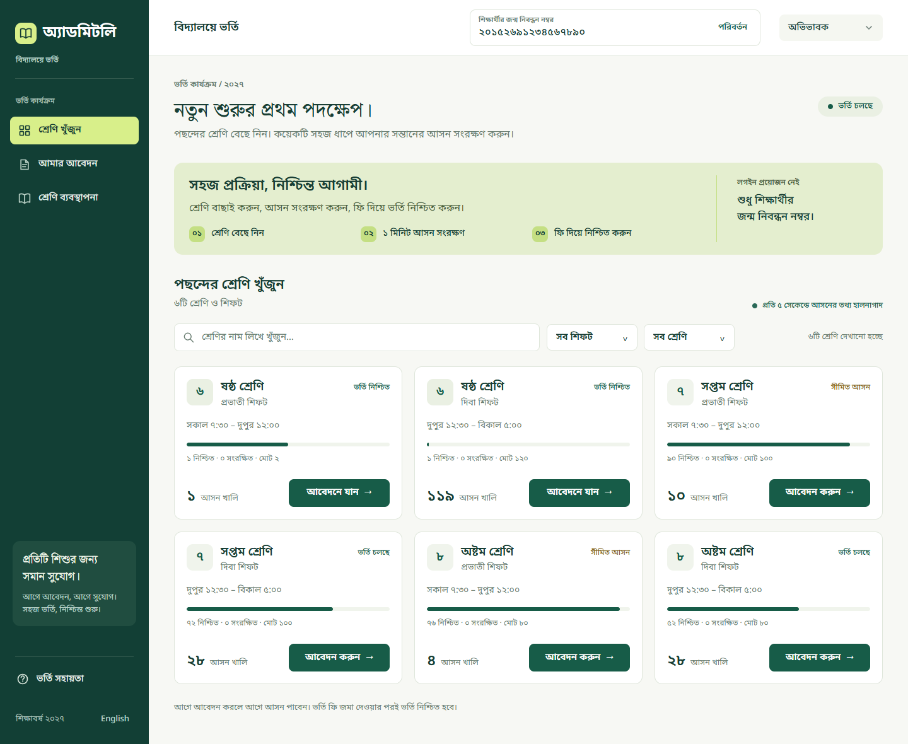
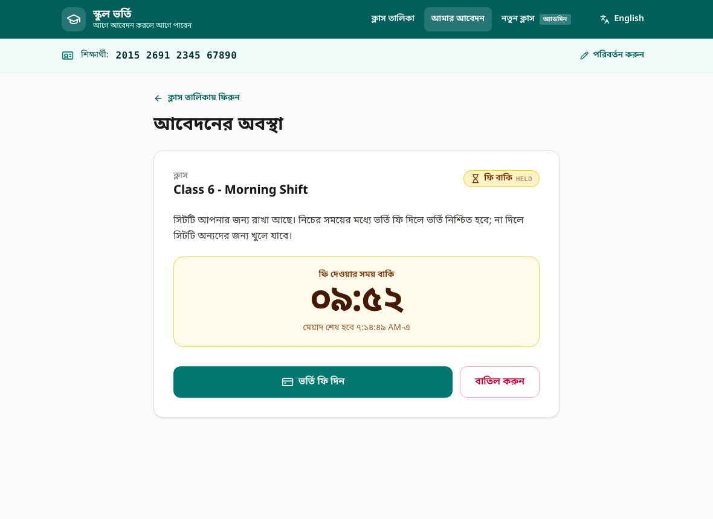
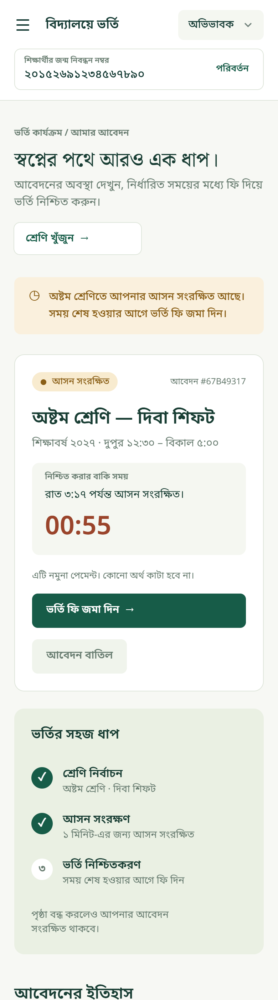

# School Admission System

First-come, first-served online admission for a school. Each class (one per shift) has a
fixed number of seats. Applying holds a seat for a limited time; paying the fee within that
time confirms the admission, otherwise the seat goes back to the pool.

| Part     | Stack                                                        |
| -------- | ------------------------------------------------------------ |
| Backend  | C# / .NET 10, ASP.NET Core minimal APIs, Npgsql (hand-written SQL) |
| Database | PostgreSQL 16                                                |
| Frontend | React 19, TypeScript, Vite, TanStack Query, Tailwind CSS     |
| Runtime  | Docker Compose                                               |



## Run it

The only requirement is Docker.

```bash
docker compose up --build
```

| What     | URL                    |
| -------- | ---------------------- |
| Frontend | http://localhost:5173  |
| Backend  | http://localhost:8080  |

The first build downloads the base images and packages, so it takes a few minutes. The
backend waits for PostgreSQL, creates the schema on first start, and is ready when
`http://localhost:8080/health` answers `{"status":"ok"}`.

Data lives in a named Docker volume, so `docker compose down` followed by
`docker compose up` keeps every class and application. (`docker compose down -v` deletes it.)

## Using the UI

The sidebar has three sections; the switch at the top right jumps between the guardian
and admin sides.

1. **শ্রেণি ব্যবস্থাপনা / Class management** (admin): seat totals for the whole school, a
   table of every class, and a form to create one. Put the shift in the name, e.g.
   "Class 6 - Morning Shift" and "Class 6 - Day Shift"; each shift is its own class.
2. Type the student's 17-digit birth registration number in the box in the top bar. There is
   no login; this number identifies the student and is remembered in the browser.
3. **শ্রেণি খুঁজুন / Find a class**: every class with its confirmed, held and free seats
   (refreshed every 5 seconds), searchable and filterable by shift and class. Press **Apply**.
4. **আমার আবেদন / My applications**: the current application with a countdown, then the
   history of all applications. **Pay admission fee** opens a review page where the
   simulated payment confirms the admission; **Cancel application** asks for confirmation on
   a page of its own. When the time runs out the application switches to EXPIRED by itself
   and paying is no longer offered (on the payment page the button is disabled).

Class names are read for display: "Class 6 - Morning Shift" appears as "ষষ্ঠ শ্রেণি · প্রভাতী
শিফট" in Bangla, with the shift's school hours. The UI is in Bangla by default; the link at the
bottom of the sidebar switches to English. On a phone the sidebar becomes a menu.

<p>
  
  
</p>

## Configuration

Everything is set through environment variables. With Docker Compose, copy `.env.example`
to `.env` and edit it, or pass values on the command line, for example
`HOLD_DURATION_SECONDS=30 docker compose up`.

| Variable                      | Used by  | Default                 | Meaning |
| ----------------------------- | -------- | ----------------------- | ------- |
| `ConnectionStrings__Database` | backend  | points at the `db` service | PostgreSQL connection string (Npgsql format). |
| `HOLD_DURATION_SECONDS`       | backend  | `600`                   | How long a seat stays held. |
| `HOLD_SWEEP_INTERVAL_SECONDS` | backend  | `30`                    | How often lapsed holds are marked EXPIRED in the database (housekeeping only). |
| `CORS_ALLOWED_ORIGINS`        | backend  | `*`                     | Comma-separated browser origins allowed to call the API. |
| `VITE_API_BASE_URL`           | frontend | `http://localhost:8080` | Backend URL the browser calls. Read when the container starts, so no rebuild is needed. Also honoured by `npm run dev` / `npm run build`. |
| `FRONTEND_PORT`               | compose  | `5173`                  | Host port for the frontend. |

## Tests

Both suites run in Docker, so nothing else needs to be installed.

```bash
# Backend: 29 integration tests against a real PostgreSQL (uses the compose database server)
docker compose --profile test run --rm --build backend-tests

# Frontend: 58 unit and screen tests
docker compose --profile test run --rm --build frontend-tests
```

The backend tests start the real API in-process on a random port and talk to it over HTTP.
Each test class creates its own throwaway database and drops it afterwards, so they never
touch application data. They cover:

- the full lifecycle of all eight endpoints, including validation and error codes;
- **concurrency**: 200 simultaneous applicants for 10 seats get exactly 10 holds; the same
  with 300 applicants spread over **two API instances** sharing one database; 30 parallel
  applications by one student give one hold; 30 parallel confirms count one seat; confirm
  racing cancel leaves exactly one winner; a churn test watches the seat numbers the whole
  time applicants apply, pay and cancel;
- expiry with a 2-second hold: the seat returns with no API call, an expired hold cannot be
  confirmed, and the student can apply again;
- data surviving a backend restart.

Running them without Docker:

```bash
# Backend (needs .NET 10 SDK and a PostgreSQL server)
cd backend
TEST_DATABASE_CONNECTION="Host=localhost;Port=5432;Database=postgres;Username=postgres;Password=postgres" dotnet test

# Frontend (needs Node 24, or 22.22+)
cd frontend
npm ci
npm test
```

## Two backends on one database (bonus)

```bash
docker compose --profile two-backends up --build
```

This adds a second backend process on http://localhost:8081 using the same database. Seat
limits still hold because they are enforced inside PostgreSQL, not in application memory;
`ASSUMPTIONS.md` explains how, and `ConcurrencyTests` proves it.

## API

Base URL `http://localhost:8080`, JSON in and out. The student is identified by the
`X-Student-Id` header (17 digits).

| # | Method and path               | Purpose                              | Success |
| - | ----------------------------- | ------------------------------------ | ------- |
| 1 | `POST /classes`               | Create a class                       | 201     |
| 2 | `GET /classes`                | All classes with seat numbers        | 200     |
| 3 | `GET /classes/{classId}`      | One class with seat numbers          | 200     |
| 4 | `POST /classes/{classId}/holds` | Apply (hold a seat)                | 201     |
| 5 | `GET /holds/{holdId}`         | Current state of an application      | 200     |
| 6 | `POST /holds/{holdId}/confirm` | Pay the fee, confirm the admission  | 200     |
| 7 | `DELETE /holds/{holdId}`      | Cancel an application                | 204     |
| 8 | `GET /me/holds`               | All applications of this student     | 200     |

Responses contain every field of the contract, plus a few extras (`className`,
`remainingSeconds`, seat numbers on `POST /classes`). One extra endpoint,
`GET /settings` → `{ "holdDurationSeconds": 600 }`, lets the UI say how long a seat is held.

Errors are RFC 9457 problem documents with a stable machine-readable `code`:

```json
{ "status": 409, "title": "Conflict", "code": "CLASS_FULL", "detail": "No seats are available in this class right now." }
```

| Status | `code`                                                             |
| ------ | ------------------------------------------------------------------ |
| 400    | `VALIDATION_FAILED`, `INVALID_REQUEST`, `STUDENT_ID_REQUIRED`, `STUDENT_ID_INVALID` |
| 403    | `NOT_HOLD_OWNER`                                                   |
| 404    | `CLASS_NOT_FOUND`, `HOLD_NOT_FOUND`                                |
| 409    | `CLASS_FULL`, `ALREADY_APPLIED`, `HOLD_EXPIRED`, `HOLD_CANCELLED`, `HOLD_ALREADY_CONFIRMED` |
| 503    | `SERVICE_UNAVAILABLE` (database unreachable)                       |

## How the seat limit is kept

`held + confirmed` can never exceed `totalSeats`:

1. Seat numbers are never stored. They are counted from the `holds` table, where a hold
   occupies a seat while it is `CONFIRMED`, or `HELD` and not yet past `expires_at`.
2. Placing a hold runs in one transaction that locks the class row
   (`SELECT ... FOR NO KEY UPDATE`), counts the occupied seats under that lock, and inserts
   the hold before releasing it. Two requests can therefore never both take the last seat,
   whichever backend process they reach.
3. A partial unique index allows one seat-occupying hold per student per class.
4. Confirm and cancel are single `UPDATE ... WHERE status = 'HELD' AND expires_at > now`
   statements, so a repeated or concurrent call changes nothing the second time.
5. Expiry needs no job: once `expires_at` passes, the hold simply stops being counted. A
   background sweeper only writes the `EXPIRED` status down afterwards.

The SQL is in `backend/src/SchoolAdmission.Api/Data/HoldRepository.cs` and the schema in
`backend/src/SchoolAdmission.Api/Data/Migrations/V001__initial_schema.sql`.

## Keeping the UI light

- **Countdowns tick on their own.** Only the timer digits read the shared clock several
  times a second. Pages use `useDeadlineClock`, which re-renders once, at the moment a hold
  expires, so a page with a running countdown is not redrawn four times a second.
- **Polling stops when it is pointless.** Class seats refresh every 5 seconds and an open
  application every 4, but not in a background tab, and an application stops polling once
  it is no longer HELD. A copy already in the cache is shown at once, also while offline.
- **Small first load.** The app code is about 28 kB gzipped; libraries sit in a separate
  `vendor` file that stays cached across releases, and the admin page is loaded only when
  someone opens it.
- **Pages feel like pages.** Each one starts at the top, moves focus to its content for
  screen readers, and names itself in the browser tab.

## Project layout

```
docker-compose.yml
backend/
  Dockerfile
  src/SchoolAdmission.Api/
    Program.cs, AdmissionApp.cs    entry point and composition root
    Configuration/                 environment settings, validated at startup
    Domain/                        StudentId, Hold, ClassSeats, HoldStatus
    Data/                          SQL migrations, repositories, migration runner
    Features/Classes, Features/Holds   endpoints, services, response contracts
    Http/                          error catalogue, problem responses, identity header
  tests/SchoolAdmission.Api.Tests/ integration tests
frontend/
  Dockerfile, nginx/               static build served by nginx
  src/
    index.css                      design tokens from the Figma file (colours, fonts)
    api/                           fetch wrapper, endpoint functions, query hooks
    pages/                         class search, my applications, payment, cancel, class management
    classes/, applications/        feature parts: class cards and name parsing; application card, history
    components/                    buttons, pills, fields, countdown; layout/ holds the sidebar shell
    student/, i18n/, hooks/, lib/  birth registration number, Bangla/English text, shared clock
    assets/icons/                  SVG icons exported from the design
```

## Local development without Docker

Needs the .NET 10 SDK, Node 24 (or 22.22+) and a PostgreSQL server. By default the backend
expects PostgreSQL on `localhost:5432` with user and password `postgres`, and uses a
database named `school_admission`, which it creates on first start if it does not exist yet.
Set `ConnectionStrings__Database` to use anything else.

```bash
# Backend on http://localhost:8080
cd backend/src/SchoolAdmission.Api
dotnet run

# Frontend on http://localhost:5173 (reads VITE_API_BASE_URL, see frontend/.env.example)
cd frontend
npm install
npm run dev
```

See `ASSUMPTIONS.md` for the decisions taken where the brief was silent, and `AI_USAGE.md`
for how AI was used.
